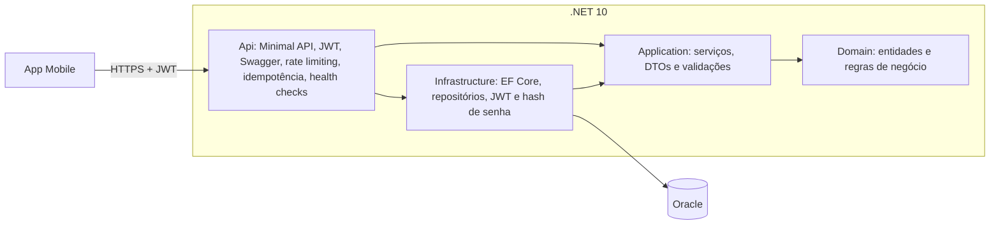

# AgroCreditoApi

> **Oportunidades que fortalecem o campo.**
> CitizenTech · Global Solution 2026/2 · FIAP · Advanced Business Development with .NET

API REST em .NET que ajuda **pequenos produtores rurais** a descobrir crédito, seguros e programas de incentivo compatíveis com a sua propriedade, a simular financiamentos e a saber quais documentos preparar. É o backend consumido pelo **app Mobile** da solução.

## Integrantes

| RM | Nome | Turma |
|---|---|---|
| 564857 | Aguinel Bento | 2TDSA |
| 563485 | Felipe Garcia | 2TDSA |
| 562086 | Henrique Gonçalves | 2TDSA |
| 562228 | Leonardo Saavedra | 2TDSA |
| 565376 | Vitor Mendes | 2TDSA |

## O problema e a solução

**Problema (tema CitizenTech):** pequenos produtores rurais não têm informação organizada para decidir. Linhas de crédito rural, seguros agrícolas e programas de incentivo ficam espalhados em vários sites e instituições, com requisitos difíceis de entender.

**Solução:** o AgroCrédito centraliza essas oportunidades e cruza o perfil da propriedade (estado, área em hectares, tipo de produção) com os critérios de cada uma. A API:

- cadastra o produtor e as suas propriedades;
- mantém um catálogo de oportunidades, com os documentos exigidos e a fonte oficial;
- **recomenda** as oportunidades compatíveis com cada propriedade, por regras determinísticas e verificáveis;
- **simula** o financiamento (parcela, total pago e juros) e guarda o histórico.

**Quem é beneficiado:** pequenos produtores rurais. **Como medir o impacto:** oportunidades encontradas, simulações realizadas e produtores atendidos.

> **Compromisso de transparência:** as recomendações são informativas e **nunca prometem aprovação de crédito**. As regras só usam critérios cadastrados, e cada oportunidade aponta a fonte oficial. Os valores de taxa, prazo e limite do catálogo inicial (seed) são **ilustrativos** para demonstração e devem ser conferidos nos editais oficiais.

### ODS relacionados

- **ODS 2:** Fome Zero e Agricultura Sustentável (fortalece a agricultura familiar e a capacidade produtiva).
- **ODS 9:** Indústria, Inovação e Infraestrutura (tecnologia para ampliar o acesso a serviços no campo).
- **ODS 10:** Redução das Desigualdades (democratiza o acesso à informação e às oportunidades financeiras).

## Arquitetura

A solução segue **Clean Architecture** em camadas. As dependências apontam para dentro: o Domínio não conhece nenhuma outra camada.



| Camada | Responsabilidade |
|---|---|
| `AgroCredito.Domain` | Entidades e regras puras: **elegibilidade** de oportunidades e **simulador de financiamento** (tabela Price). Sem dependência de banco ou framework web. |
| `AgroCredito.Application` | Casos de uso (serviços), DTOs, validações de entrada, exceções de aplicação e as **interfaces** de repositório que a infraestrutura implementa. |
| `AgroCredito.Infrastructure` | EF Core com Oracle, migrations, repositórios, geração de JWT, hash de senha (PBKDF2) e armazenamento das chaves de idempotência. |
| `AgroCredito.Api` | Minimal API: endpoints, Swagger, autenticação, rate limiting, idempotência, health checks e tratamento de erros (ProblemDetails). |

### Estrutura de pastas

```
AgroCreditoApi/
├── src/
│   ├── AgroCredito.Domain/          entidades, enums, exceções e serviços de domínio
│   ├── AgroCredito.Application/     serviços, DTOs, validações e abstrações
│   ├── AgroCredito.Infrastructure/  persistência (EF Core), migrations, JWT e hash de senha
│   └── AgroCredito.Api/             endpoints, Swagger, health checks, rate limiting, idempotência
└── tests/
    ├── AgroCredito.Domain.Tests/        testes unitários das regras de negócio
    ├── AgroCredito.Application.Tests/   testes unitários dos serviços (repositórios falsos)
    └── AgroCredito.Api.Tests/           testes unitários e de integração (API inteira em memória)
```

## Tecnologias

- .NET 10, ASP.NET Core **Minimal APIs**
- **EF Core** com **Oracle** (`Oracle.EntityFrameworkCore`) e migrations
- Autenticação **JWT Bearer**
- **Swagger / OpenAPI** (Swashbuckle)
- Rate limiting nativo do ASP.NET Core
- Health Checks do ASP.NET Core
- **xUnit** para testes unitários e de integração (`Microsoft.AspNetCore.Mvc.Testing`)

## Como executar

### Pré-requisitos

- [.NET SDK 10](https://dotnet.microsoft.com/download)
- Acesso a um banco **Oracle** (o grupo usa o Oracle da FIAP) com um usuário que possa criar tabelas
- Git

### Passo a passo

1. Clone o repositório:

   ```bash
   git clone https://github.com/Felipesgh/AgroCreditoApi.git
   cd AgroCreditoApi
   ```

2. Configure a conexão com o banco e a chave do JWT. **Nenhuma credencial fica no repositório**: use o *user-secrets* (ou variáveis de ambiente). O arquivo `src/AgroCredito.Api/appsettings.Example.json` mostra o formato esperado.

   ```bash
   dotnet user-secrets set "ConnectionStrings:Default" "User Id=<usuario>;Password=<senha>;Data Source=oracle.fiap.com.br:1521/ORCL" --project src/AgroCredito.Api
   dotnet user-secrets set "Jwt:Key" "<chave-aleatoria-com-32-ou-mais-caracteres>" --project src/AgroCredito.Api
   ```

   Alternativa com variáveis de ambiente: `ConnectionStrings__Default` e `Jwt__Key`.

3. Execute a API:

   ```bash
   dotnet run --project src/AgroCredito.Api
   ```

   Ao iniciar, a API **aplica as migrations** e carrega as **5 oportunidades iniciais** (seed). Abra a URL mostrada no terminal (por exemplo `http://localhost:5277`): a raiz redireciona para o **Swagger** em `/swagger`.

4. (Opcional) Gere o script SQL do banco a partir das migrations:

   ```bash
   dotnet ef migrations script --idempotent --project src/AgroCredito.Infrastructure --startup-project src/AgroCredito.Api -o script-bd.sql
   ```

### Usuários de teste

Não há usuário pré-cadastrado: crie um pelo Swagger em `POST /api/auth/register`. Exemplo:

```json
{ "nome": "Maria Silva", "email": "maria@teste.com", "senha": "Senha1234" }
```

A senha precisa ter de 8 a 100 caracteres, com letras e números.

### Fluxo para testar no Swagger

1. `POST /api/auth/register` cria o produtor.
2. `POST /api/auth/login` devolve o `accessToken`.
3. Clique em **Authorize**, cole apenas o token e confirme. As rotas protegidas têm um cadeado.
4. `POST /api/propriedades` cadastra uma propriedade:

   ```json
   {
     "nome": "Sítio Boa Vista",
     "estado": "SP",
     "municipio": "Ibiúna",
     "areaHectares": 15,
     "tipoProducao": "Horticultura",
     "cultura": "Alface"
   }
   ```

5. `GET /api/propriedades/{id}/recomendacoes` lista as oportunidades compatíveis.
6. `POST /api/propriedades/{id}/simulacoes` simula o financiamento:

   ```json
   { "oportunidadeId": 1, "valor": 50000, "prazoMeses": 24 }
   ```

## Endpoints

| Método e rota | Acesso | Descrição | Respostas |
|---|---|---|---|
| `POST /api/auth/register` | público | Cadastra um produtor | 201, 400, 409, 429 |
| `POST /api/auth/login` | público | Autentica e devolve o JWT | 200, 400, 401, 429 |
| `GET /api/produtores/me` | JWT | Dados do produtor logado | 200, 401 |
| `GET /api/oportunidades` | público | Lista o catálogo (filtro `?tipo=`) | 200, 400 |
| `GET /api/oportunidades/{id}` | público | Detalha uma oportunidade e seus documentos | 200, 404 |
| `GET /api/propriedades` | JWT | Lista as propriedades do produtor | 200, 401 |
| `POST /api/propriedades` | JWT | Cadastra uma propriedade (aceita `Idempotency-Key`) | 201, 400, 401, 409, 422 |
| `GET /api/propriedades/{id}` | JWT | Detalha uma propriedade | 200, 401, 404 |
| `PUT /api/propriedades/{id}` | JWT | Atualiza uma propriedade | 200, 400, 401, 404 |
| `DELETE /api/propriedades/{id}` | JWT | Exclui uma propriedade | 204, 401, 404 |
| `GET /api/propriedades/{id}/recomendacoes` | JWT | Oportunidades compatíveis com a propriedade | 200, 401, 404 |
| `POST /api/propriedades/{id}/simulacoes` | JWT | Simula um financiamento (aceita `Idempotency-Key`) | 201, 400, 401, 404, 409, 422 |
| `GET /api/propriedades/{id}/simulacoes` | JWT | Histórico de simulações | 200, 401, 404 |
| `GET /health` | público | A API está de pé? (liveness) | 200 |
| `GET /health/ready` | público | Banco e serviço externo (readiness) | 200, 503 |

Valores de `tipoProducao`: `Agricultura`, `Horticultura`, `Fruticultura`, `Pecuaria`, `Misto`. Valores de `tipo` das oportunidades: `CreditoRural`, `Seguro`, `ProgramaGoverno`, `Incentivo`.

## Regras de negócio

- **Elegibilidade:** uma oportunidade é recomendada se estiver ativa e se a propriedade atender aos critérios cadastrados: estado, tipo de produção e área mínima e máxima em hectares. Critério em branco significa sem restrição.
- **Simulação (tabela Price):** a taxa anual da oportunidade vira taxa mensal equivalente, `i = (1 + anual)^(1/12) − 1`, e a parcela é `valor · i / (1 − (1 + i)^−n)`. A simulação respeita o **valor máximo** e o **prazo máximo** da linha e só vale para propriedades elegíveis. É uma **estimativa**, não uma oferta de crédito.
- **Isolamento por produtor:** cada produtor só enxerga e altera as próprias propriedades e simulações (o id vem do token, nunca do corpo da requisição).

## Segurança

- **JWT (HS256)**, validade de 60 minutos, com as claims `sub`, `name`, `email` e `role`. A API valida assinatura, emissor, público e expiração.
- Senhas guardadas com **PBKDF2-SHA256** (600 mil iterações, sal aleatório por senha). A mensagem de erro do login é a mesma para e-mail inexistente e senha errada.
- **Segredos fora do repositório:** a connection string do Oracle e a chave do JWT vêm do *user-secrets* ou de variáveis de ambiente.
- Rotas protegidas exigem `Authorization: Bearer <token>`. O catálogo de oportunidades é público.

## Idempotência (`Idempotency-Key`)

Nos `POST` que criam dados (`/api/propriedades` e `/api/propriedades/{id}/simulacoes`), o cliente pode enviar o header `Idempotency-Key` (por exemplo, um GUID). Repetir a requisição não cria um segundo registro.

| Situação | Resultado |
|---|---|
| Sem o header | Funciona normalmente |
| Chave nova | Processa e guarda a resposta |
| Mesma chave e mesmo conteúdo | Devolve a **mesma resposta** guardada, com o header `Idempotent-Replayed: true` |
| Mesma chave e conteúdo diferente | **422** |
| Mesma chave enquanto a primeira ainda processa | **409** |
| A primeira tentativa falhou (400, 404, 422) | A chave é liberada para nova tentativa |

As chaves valem por produtor, ficam guardadas por 24 horas e a reserva usa um índice único no banco, para suportar requisições simultâneas.

## Rate limiting

| Política | Onde | Limite padrão |
|---|---|---|
| Geral | Todas as rotas | 100 requisições por minuto, por produtor logado ou, sem login, por IP (janela deslizante) |
| Autenticação | `/api/auth/login` e `/api/auth/register` | 10 requisições por minuto, por IP (janela fixa) |

Ao exceder o limite, a API responde **429 Too Many Requests** com o header `Retry-After` e um corpo no padrão ProblemDetails. `/swagger` e `/health` não têm limite. Os valores são configuráveis em `RateLimiting` no `appsettings.json`.

## Health checks

- `GET /health`: a API está no ar (*liveness*).
- `GET /health/ready`: verifica o **banco Oracle** (`Unhealthy` e HTTP 503 se estiver inacessível) e um **serviço externo**, por padrão a API pública do Banco Central do Brasil (`Degraded` e HTTP 200 se estiver indisponível, pois a API segue funcionando). A URL é configurável em `HealthChecks:ExternalService`.

## Tratamento de erros

Todos os erros seguem o padrão **ProblemDetails** (`title`, `status`, `detail`). Erros de validação (400) incluem também o campo `errors` com as mensagens por campo.

| Código | Quando acontece |
|---|---|
| 400 | Dados inválidos ou JSON mal formado |
| 401 | Sem token, token inválido ou expirado, ou login recusado |
| 404 | Recurso inexistente (ou de outro produtor) |
| 409 | E-mail já cadastrado, ou requisição idempotente em andamento |
| 422 | Regra de negócio violada (propriedade não elegível, valor ou prazo acima do limite, chave de idempotência reutilizada com outro conteúdo) |
| 429 | Limite de requisições excedido |
| 503 | Banco de dados inacessível (`/health/ready`) |

## Testes

```bash
dotnet test
```

- **Unitários, Domínio:** elegibilidade e simulador de financiamento.
- **Unitários, Application:** serviços (propriedades, recomendações, simulações, autenticação, idempotência) com repositórios falsos em memória.
- **Unitários, infraestrutura e API:** hash de senha, geração do JWT e health check de serviço externo.
- **Integração:** a API inteira sobe dentro do teste, com banco em memória no lugar do Oracle, e cobre cadastro, login, JWT, CRUD de propriedades, recomendações, simulações, isolamento entre produtores, idempotência, rate limiting (429 e `Retry-After`), health checks e Swagger. Os testes de integração **não dependem de rede nem de credenciais**.

## Integração com o app Mobile

O app Mobile consome esta API para **todas** as funcionalidades, inclusive cadastro e login.

1. **Cadastro:** `POST /api/auth/register` com `{ nome, email, senha }`.
2. **Login:** `POST /api/auth/login` devolve `{ accessToken, tokenType, expiresIn }`. O app guarda o token (por exemplo, em armazenamento seguro) e envia `Authorization: Bearer <token>` nas demais chamadas.
3. **Logout:** o app descarta o token guardado.
4. **Token expirado:** a API responde 401, e o app leva o usuário de volta ao login.
5. **Erros:** o corpo é JSON com `title` e `detail` (e `errors` na validação), para mostrar mensagens por campo.
6. **POST que cria dados:** envie `Idempotency-Key` para evitar duplicidade em caso de nova tentativa.
7. **429:** respeite o header `Retry-After` antes de tentar de novo.
